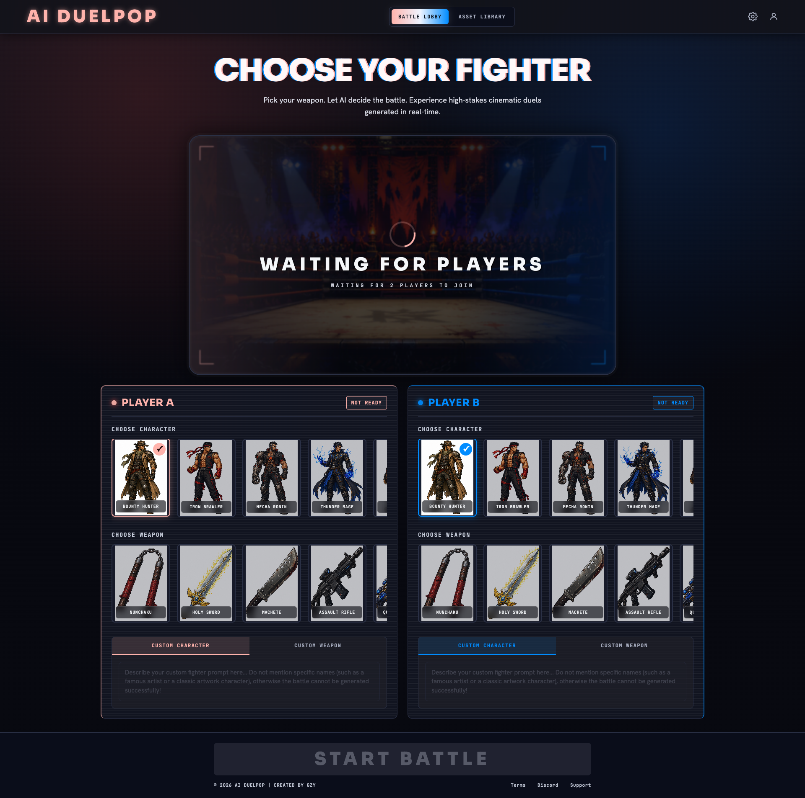

# AI DuelPop

[English](README.md) | **简体中文**

## Mock 演示

> **Mock 演示视频：未调用真实 AI 模型进行生成，仅用于展示效果。**

[](docs/media/ai-duelpop-mock-demo.mp4)

**[▶ 观看 mock 演示（含声音）](docs/media/ai-duelpop-mock-demo.mp4)** · 63 秒

一个在本机运行的双人擂台对战原型。选择角色与武器，进行模拟对战，观看演示视频，并在素材库中查看结果。

**默认运行 mock 模式。** 使用仓库自带的占位图片、视频及确定性的规则评分，不调用真实 AI 模型，也不需要账号、API Key 或模型额度。视频用于展示界面与交互流程，不代表实时生成效果。

## 当前版本边界

此版本是一条固定链路，更多用于验证链路和测试效果，后续作为直播 AI 擂台对战互动玩法的基底，暂不支持切换至其他图片/视频模型资源进行生成（只能通过 PixVerse CLI 进行模型调用）。

具体来说，图像和视频生成通过 PixVerse CLI 调用，Qwen 通过独立接口担任裁判。默认 mock 模式不进行任何真实模型调用。

## 快速开始

### 运行 mock 演示

安装 [Git](https://git-scm.com/) 和 [Node.js 22.12 或更新版本](https://nodejs.org/)（包含 npm）。在终端中检查安装：

```bash
git --version
node --version
npm --version
```

然后下载并启动：

```bash
git clone https://github.com/stepparo2003-arch/AI_DuelPop.git ai-duelpop
cd ai-duelpop
npm run dev
```

打开 **http://127.0.0.1:8787**。应用仅依赖 Node.js 内置模块，mock 模式**无需执行 `npm install`**。使用期间请保持终端运行，按 **Ctrl+C** 停止服务。macOS 用户安装 Node.js 后，也可以在项目目录执行 `./start-backend.command`。如果下载的是 ZIP，请先解压，在解压后的项目目录打开终端，再执行 `npm run dev`。

为双方各选择一个角色和一件武器，点击 **Start Battle（开始对战）**，等待准备完成后点击 **Play Battle（播放对战）**。对战视频有声音，等候画面保持静音。已完成的对战及分析会保存到本机素材库。

使用 **Custom Character（自定义角色）** 或 **Custom Weapon（自定义武器）** 时，请再次点击已选中的预设卡片以取消选择，然后切换到对应的自定义标签并填写描述。选中预设会禁用对应文本框；若要重新选择预设，请先清空对应的自定义文字。mock 模式下，自定义文字仅参与模拟评分，不会生成新素材。

可选配置：

```bash
cp .env.example .env
```

不创建此文件也能按默认设置运行。如果 8787 端口被占用（出现 `EADDRINUSE`），复制模板后，将 `.env` 中的 `PORT=8787` 改为 `PORT=8788`，重启服务，并改为打开 **http://127.0.0.1:8788**。终端中已设置的环境变量优先于 `.env`；如果之前设置过 `APP_MODE=real`，请移除它以返回 mock 模式。

可访问 **http://127.0.0.1:8787/api/health**（或你设置的端口）检查状态。默认 mock 模式应返回 `"mode":"mock"`，且 `imageProvider`、`judgeProvider`、`videoProvider` 均为 `"mock"`。

### 可选：真实模型生成

上述快速开始仅验证本地 mock 体验。真实生成还需要 PixVerse CLI 登录、模型额度、兼容的 Qwen 模型及 DashScope／百炼 API Key。请参阅[真实模型配置说明（英文）](docs/real-model-setup.md)。

这些真实集成尚未通过付费模型调用完成端到端验证，因此 mock 演示运行成功，不代表真实模型生成也已验证可用。

## 功能与状态

| 功能 | 当前行为 |
| --- | --- |
| 双方角色与武器选择 | 支持预设选择和自定义描述输入 |
| Mock 对战 | 使用自带图片、视频，以及确定性的胜负判定和分析 |
| 视频播放 | 点击播放后开启对战声音；等候视频静音循环 |
| 素材库 | 保存本地对战记录、提示词和媒体引用 |
| 真实图片生成 | 可选的 PixVerse CLI／Seedream 适配 |
| 真实裁判 | 可选的 Qwen 适配 |
| 真实视频生成 | 固定的 PixVerse CLI／V6 适配 |

真实集成依赖账号凭据、可用模型和额度，**mock 演示及 CI 不会验证这些真实接口**。启用方式和限制见[真实模型配置说明（英文）](docs/real-model-setup.md)。

## 实际实现的链路

**真实模式**当前按以下顺序运行：

1. 预设选项提供名称、描述和仓库内的参考图；自定义角色／武器只提供文字。
2. 后端将双方描述嵌入固定场景模板，结合擂台背景和可用的预设参考图，通过 PixVerse CLI 调用 Seedream 4.5，一次生成整张对峙图。
3. Qwen 接收对峙图、双方文字配置和裁判规则，输出胜方、结果摘要及赛后分析。
4. 后端只将胜方／败方的左右位置填入固定视频提示词，通过 PixVerse CLI 调用 V6，以对峙图为输入生成视频，最后在界面中播放并归档。

自定义输入**不会先分别生成独立角色图／武器图**，也没有额外的大模型提示词增强步骤。Qwen **不会生成视频提示词或动作编排**。默认 mock 模式用自带素材和规则评分替代模型步骤。

当前支持的集成链路是固定的，但 `.env` 仍保留高级 CLI 命令覆盖能力，并非从代码上硬性禁止自定义命令。切换其他模型或服务不属于已记录、已验证的工作流。若修改生成时长，请同时调整 CLI 命令和固定视频提示词中的时长，保持一致。

## 项目结构

```text
.github/workflows/    自动语法检查和集成测试
assets/static/       角色、武器、擂台及演示素材
backend/             HTTP 服务、对战编排、提示词和模型适配
frontend/app/        单页界面
scripts/             无额外依赖的开发检查脚本
tests/               Mock 链路与静态文件访问安全测试
docs/                配置、设计文档与素材来源说明
  media/             README 演示视频和展示图
```

`backend/data/` 和 `backend/generated/` 是运行时输出目录，已被 Git 忽略。API 详情见[后端说明（英文）](backend/README.md)。`docs/` 中的设计文档描述原型设计意图，可能包含规划功能；当前实现请以上方功能状态表为准。

## 检查与测试

```bash
npm run check
npm test
```

检查覆盖后端及前端内联 JavaScript 语法、完整 mock 对战、历史记录持久化、视频分段请求、私有文件访问拦截，以及严格真实模式的失败行为。GitHub Actions 在 Node.js 22 和 24 上运行检查。

## 本地使用与限制

- 这是本地原型，请保持 `HOST=127.0.0.1`。目前没有身份认证、请求限流或多用户隔离，不适合直接部署为公网服务。
- 静态访问仅开放前端文件及受支持的媒体文件，不开放 `.env`、后端源码、原始历史记录和生成提示词文件。
- 素材库 API 会向界面提供本机用户的历史记录，不构成不同用户之间的隐私隔离。
- 真实 Key 仅保存在 `.env` 中。不要提交账号凭据、生成内容或私密提示词，详见[安全说明（英文）](SECURITY.md)。
- 字体通过 Google Fonts 加载，离线或网络受限时可能使用备用字体。
- Mock 素材固定，所选角色、规则判定的胜方与视频画面可能并不对应。

## 许可证与素材

原创代码和文档采用 [MIT 许可](LICENSE)。图片、视频、音频、截图、字体及其他第三方内容不包含在这项授权内。素材来源状态及使用限制见[素材来源与署名说明（英文）](docs/assets-and-credits.md)。
